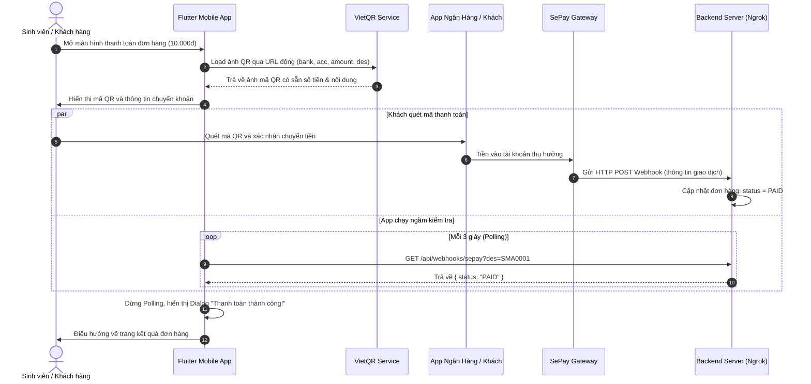

# BÀI LAB: TÍCH HỢP THANH TOÁN TỰ ĐỘNG QUA MÃ VIETQR VÀ SEPAY TRONG FLUTTER

* **Môn học**: PRM393 - Mobile Programming (Flutter)
* **Chủ đề**: Tích hợp Cổng thanh toán chuyển khoản Ngân hàng tự động (VietQR + SePay Webhook)
* **Thời lượng ước tính**: 90 - 120 phút

---

## I. MỤC TIÊU BÀI LAB

Sau khi hoàn thành bài lab này, sinh viên có khả năng:
1. **Hiểu rõ nguyên lý hoạt động** của thanh toán ngân hàng tự động qua mã VietQR và cơ chế Webhook của SePay.
2. **Sinh mã QR động** theo chuẩn VietQR thông qua API hình ảnh mà không cần cài đặt thêm SDK cồng kềnh.
3. **Xây dựng giao diện thanh toán** thân thiện: hiển thị ảnh QR, hỗ trợ sao chép số tài khoản, số tiền và nội dung chuyển khoản nhanh chóng.
4. **Xây dựng cơ chế kiểm tra trạng thái thanh toán** tự động (Polling HTTP) bằng `dart:io` và `Timer.periodic`.
5. **Hiểu cách cấu hình Ngrok** để nhận Webhook từ SePay khi phát triển ở môi trường Localhost.

---

## II. KIẾN TRÚC VÀ LUỒNG HOẠT ĐỘNG (FLOW)



---

## III. YÊU CẦU CHUẨN BỊ

* Flutter SDK: Phiên bản >= 3.0.0
* Editor: VS Code hoặc Android Studio (đã cài Flutter & Dart extension)
* Thiết bị: Điện thoại thật hoặc Máy ảo Android/iOS (có kết nối mạng)
* Tài khoản SePay (miễn phí tại [sepay.vn](https://sepay.vn)) hoặc sử dụng link API Mock/Ngrok do giảng viên cung cấp.

---

## IV. CÁC BƯỚC THỰC HIỆN CHI TIẾT

### BƯỚC 1: Khởi tạo dự án Flutter

Mở terminal tại thư mục bài tập của bạn và chạy lệnh:
```bash
flutter create payment_flutter
cd payment_flutter
```

Kiểm tra file `pubspec.yaml`, dự án chỉ sử dụng các thư viện có sẵn của Flutter mà **không cần cài đặt thêm bất kỳ SDK nào**:
```yaml
name: payment_flutter
description: "Demo Thanh toan VietQR SePay"
publish_to: 'none'
version: 1.0.0+1

environment:
  sdk: '>=3.0.0 <4.0.0'

dependencies:
  flutter:
    sdk: flutter

dev_dependencies:
  flutter_test:
    sdk: flutter
  flutter_lints: ^3.0.0

flutter:
  uses-material-design: true
```

Chạy lệnh cập nhật package:
```bash
flutter pub get
```

---

### BƯỚC 2: Hiểu cấu trúc URL VietQR động

VietQR cung cấp API tạo ảnh mã QR nhanh qua đường dẫn URL dạng:
```
https://vietqr.app/img?bank=<TÊN_NGÂN_HÀNG>&acc=<SỐ_TÀI_KHOẢN>&template=<GIAO_DIỆN>&amount=<SỐ_TIỀN>&des=<NỘI_DUNG>
```

**Bảng giải thích tham số:**
| Tham số | Ý nghĩa | Ví dụ |
| :--- | :--- | :--- |
| `bank` | Tên viết tắt hoặc mã ngân hàng thụ hưởng | `Vietcombank`, `MBBank`, `Techcombank`,... |
| `acc` | Số tài khoản ngân hàng nhận tiền | `SBSEPAYPFJHZ4SXKYXH` |
| `amount`| Số tiền chuyển khoản (VND) | `10000` |
| `des` | **Nội dung chuyển khoản (Bắt buộc duy nhất)** để SePay phân biệt đơn hàng | `SMA0001`, `DH10023` |
| `template`| Giao diện mã QR: `compact` (gọn kèm logo), `qronly` (chỉ khung QR) | `compact` |

> ⚠️ **Lưu ý quan trọng**: Nội dung chuyển khoản (`des`) phải là **duy nhất** cho mỗi đơn hàng (ví dụ: mã đơn hàng). Khi tiền vào tài khoản, SePay sẽ đọc nội dung này để biết đơn hàng nào đã được thanh toán.

---

### BƯỚC 3: Xây dựng màn hình `sepay_qr_screen.dart`

Tạo mới file `lib/sepay_qr_screen.dart`. Màn hình này gồm các chức năng hoàn chỉnh:
1. Cho phép người dùng **nhập số tiền tùy ý** hoặc chọn nhanh mệnh giá (`10.000đ`, `20.000đ`, `50.000đ`, `100.000đ`).
2. **Tự động sinh nội dung chuyển khoản duy nhất** (VD: `SMA4821`) kèm nút làm mới mã đơn.
3. Sinh URL động và hiển thị ảnh mã QR VietQR tương ứng ngay tức thì.
4. Cho phép người dùng bấm sao chép STK, Số tiền, Nội dung CK tiện lợi.
5. Tự động kiểm tra trạng thái thanh toán bằng Polling định kỳ mỗi 3 giây (kèm nút Giả lập Test thành công).

Dán đoạn code hoàn chỉnh từ file [lib/sepay_qr_screen.dart](file:///d:/FPTU/FALL%202026/PRM393/Payment_flutter/lib/sepay_qr_screen.dart) vào dự án.

```dart
import 'dart:async';
import 'dart:convert';
import 'dart:io';
import 'package:flutter/material.dart';
import 'package:flutter/services.dart';

class SepayQrScreen extends StatefulWidget {
  final String bank;
  final String acc;
  final int amount;
  final String des;
  final String template;
  final String checkStatusUrl;

  const SepayQrScreen({
    super.key,
    this.bank = 'Vietcombank',
    this.acc = 'SBSEPAYPFJHZ4SXKYXH',
    this.amount = 10000,
    this.des = 'SMA0001',
    this.template = 'compact',
    this.checkStatusUrl = 'https://seminar-impatient-muck.ngrok-free.dev/api/webhooks/sepay',
  });

  @override
  State<SepayQrScreen> createState() => _SepayQrScreenState();
}

class _SepayQrScreenState extends State<SepayQrScreen> {
  Timer? _pollingTimer;
  bool _isChecking = false;
  bool _isPaid = false;

  // 1. Sinh đường dẫn ảnh mã VietQR
  String get qrUrl {
    final uri = Uri.https('vietqr.app', '/img', {
      'bank': widget.bank,
      'acc': widget.acc,
      'template': widget.template,
      'amount': widget.amount.toString(),
      'des': widget.des,
    });
    return uri.toString();
  }

  @override
  void initState() {
    super.initState();
    // 2. Kích hoạt timer tự động polling kiểm tra thanh toán mỗi 3 giây
    _startPolling();
  }

  @override
  void dispose() {
    // 3. Huỷ timer khi thoát màn hình để tránh rò rỉ bộ nhớ (memory leak)
    _pollingTimer?.cancel();
    super.dispose();
  }

  void _startPolling() {
    _pollingTimer = Timer.periodic(const Duration(seconds: 3), (timer) {
      if (!_isChecking && !_isPaid) {
        _checkPaymentStatus();
      }
    });
  }

  // 4. Gửi request kiểm tra trạng thái thanh toán
  Future<void> _checkPaymentStatus() async {
    if (_isChecking || _isPaid) return;
    setState(() => _isChecking = true);

    try {
      final client = HttpClient();
      final parsedUri = Uri.parse(widget.checkStatusUrl);
      
      // Gắn tham số query mã đơn hàng vào URL
      final checkUri = parsedUri.replace(
        queryParameters: {
          ...parsedUri.queryParameters,
          'des': widget.des,
          'amount': widget.amount.toString(),
        },
      );

      final request = await client.getUrl(checkUri);
      // Header vượt qua màn hình cảnh báo của ngrok free
      request.headers.set('ngrok-skip-browser-warning', 'true');
      request.headers.set('Accept', 'application/json');

      final response = await request.close().timeout(const Duration(seconds: 5));

      if (response.statusCode == 200) {
        final body = await response.transform(utf8.decoder).join();
        final data = jsonDecode(body);

        // Kiểm tra điều kiện đơn hàng đã thanh toán thành công
        bool isSuccess = data['status'] == 'PAID' ||
            data['status'] == 'success' ||
            data['isPaid'] == true ||
            data['success'] == true;

        if (isSuccess && mounted) {
          _handlePaymentSuccess();
        }
      }
    } catch (e) {
      debugPrint('Lỗi polling: $e');
    } finally {
      if (mounted) {
        setState(() => _isChecking = false);
      }
    }
  }

  // 5. Xử lý khi thanh toán thành công
  void _handlePaymentSuccess() {
    _pollingTimer?.cancel();
    setState(() => _isPaid = true);

    showDialog(
      context: context,
      barrierDismissible: false,
      builder: (ctx) => AlertDialog(
        icon: const Icon(Icons.check_circle, color: Colors.green, size: 64),
        title: const Text('Thanh toán thành công!'),
        content: Text('Đơn hàng ${widget.des} đã được thanh toán thành công số tiền ${widget.amount} đ.'),
        actions: [
          ElevatedButton(
            onPressed: () {
              Navigator.pop(ctx);
              Navigator.pop(context, true);
            },
            child: const Text('Hoàn tất'),
          ),
        ],
      ),
    );
  }

  void _copyToClipboard(String label, String value) {
    Clipboard.setData(ClipboardData(text: value));
    ScaffoldMessenger.of(context).showSnackBar(
      SnackBar(content: Text('Đã sao chép $label: $value'), duration: const Duration(seconds: 2)),
    );
  }

  @override
  Widget build(BuildContext context) {
    return Scaffold(
      appBar: AppBar(title: const Text('Thanh toán đơn hàng'), centerTitle: true),
      body: SingleChildScrollView(
        padding: const EdgeInsets.all(16.0),
        child: Column(
          children: [
            const Text(
              'Quét mã QR bằng ứng dụng ngân hàng',
              style: TextStyle(fontSize: 16, fontWeight: FontWeight.bold),
            ),
            const SizedBox(height: 16),

            // Ảnh mã VietQR
            Center(
              child: ClipRRect(
                borderRadius: BorderRadius.circular(12),
                child: Image.network(
                  qrUrl,
                  width: 280,
                  fit: BoxFit.contain,
                  loadingBuilder: (context, child, progress) =>
                      progress == null ? child : const SizedBox(height: 280, child: Center(child: CircularProgressIndicator())),
                  errorBuilder: (context, error, stackTrace) =>
                      const SizedBox(height: 280, child: Center(child: Text('Lỗi tải mã QR!'))),
                ),
              ),
            ),

            const SizedBox(height: 20),
            const Divider(),

            // Danh sách thông tin chi tiết kèm nút copy
            _buildInfoRow('Ngân hàng', widget.bank),
            _buildInfoRow('Số tài khoản', widget.acc, canCopy: true),
            _buildInfoRow(
              'Số tiền',
              '${widget.amount.toString().replaceAllMapped(RegExp(r'(\d{1,3})(?=(\d{3})+(?!\d))'), (m) => '${m[1]}.')} đ',
              canCopy: true,
              copyValue: widget.amount.toString(),
            ),
            _buildInfoRow('Nội dung CK', widget.des, canCopy: true, highlight: true),

            const SizedBox(height: 24),

            // Hiển thị trạng thái đang chờ thanh toán
            if (!_isPaid) ...[
              Row(
                mainAxisAlignment: MainAxisAlignment.center,
                children: [
                  const SizedBox(width: 16, height: 16, child: CircularProgressIndicator(strokeWidth: 2)),
                  const SizedBox(width: 10),
                  Text(
                    _isChecking ? 'Đang kiểm tra...' : 'Tự động kiểm tra mỗi 3s...',
                    style: const TextStyle(color: Colors.grey, fontStyle: FontStyle.italic),
                  ),
                ],
              ),
              const SizedBox(height: 16),
              OutlinedButton.icon(
                icon: const Icon(Icons.refresh),
                label: const Text('Tôi đã chuyển khoản (Kiểm tra ngay)'),
                onPressed: _isChecking ? null : _checkPaymentStatus,
              ),
            ],
          ],
        ),
      ),
    );
  }

  Widget _buildInfoRow(String label, String value, {bool canCopy = false, String? copyValue, bool highlight = false}) {
    return Padding(
      padding: const EdgeInsets.symmetric(vertical: 6.0),
      child: Row(
        mainAxisAlignment: MainAxisAlignment.spaceBetween,
        children: [
          Text(label, style: const TextStyle(color: Colors.black54)),
          Row(
            children: [
              Text(
                value,
                style: TextStyle(fontWeight: FontWeight.bold, color: highlight ? Colors.red : Colors.black87),
              ),
              if (canCopy) ...[
                const SizedBox(width: 6),
                IconButton(
                  icon: const Icon(Icons.copy, size: 18, color: Colors.blue),
                  onPressed: () => _copyToClipboard(label, copyValue ?? value),
                  padding: EdgeInsets.zero,
                  constraints: const BoxConstraints(),
                ),
              ],
            ],
          ),
        ],
      ),
    );
  }
}
```

---

### BƯỚC 4: Cập nhật `lib/main.dart` để khởi chạy

Mở file `lib/main.dart` và thay thế bằng nội dung sau:

```dart
import 'package:flutter/material.dart';
import 'sepay_qr_screen.dart';

void main() {
  runApp(const MyApp());
}

class MyApp extends StatelessWidget {
  const MyApp({super.key});

  @override
  Widget build(BuildContext context) {
    return MaterialApp(
      title: 'Demo Thanh Toán SePay',
      debugShowCheckedModeBanner: false,
      theme: ThemeData(
        colorScheme: ColorScheme.fromSeed(seedColor: Colors.blue),
        useMaterial3: true,
      ),
      home: const SepayQrScreen(
        bank: 'Vietcombank',
        acc: 'SBSEPAYPFJHZ4SXKYXH',
        amount: 10000,
        des: 'SMA0001',
        template: 'compact',
        checkStatusUrl: 'https://seminar-impatient-muck.ngrok-free.dev/api/webhooks/sepay',
      ),
    );
  }
}
```

---

### BƯỚC 5: Thiết lập Webhook Backend và Thử nghiệm

#### 1. Tại sao gặp lỗi 404 và cách giải quyết?
* **Nguyên nhân**: Endpoint Webhook của SePay (`/api/webhooks/sepay`) thường chỉ nhận phương thức **POST**. Khi App Flutter gửi request **GET** để kiểm tra trạng thái đơn hàng, nếu Backend chưa viết hàm xử lý `GET`, server sẽ báo **Lỗi 404 (Not Found)**.
* **Giải pháp**: Dự án đã chuẩn bị sẵn file [server_webhook.js](file:///d:/FPTU/FALL%202026/PRM393/Payment_flutter/server_webhook.js) bằng Node.js thuần (không cần cài thêm npm). Server này hỗ trợ:
  * Nhận `POST /api/webhooks/sepay` từ SePay khi tiền về.
  * Nhận `GET /api/webhooks/sepay?des=SMA0001` từ Flutter App để trả về trạng thái `{ status: "PAID" }`.
  * Endpoint kích hoạt thanh toán test: `GET /api/mock-pay?des=SMA0001`.

#### 2. Cách chạy Backend Mock và Ngrok:
* **Bước 5.1 - Chạy Backend:**
  Mở 1 Terminal mới và gõ lệnh:
  ```bash
  node server_webhook.js
  ```
  *(Server sẽ lắng nghe tại cổng `http://localhost:3000`)*

* **Bước 5.2 - Bật Ngrok:**
  Mở thêm 1 Terminal nữa và chạy:
  ```bash
  ngrok http 3000
  ```
  Ngrok sẽ cấp cho bạn một URL công khai dạng:
  `https://seminar-impatient-muck.ngrok-free.dev` -> Trỏ về cổng 3000.

#### 3. Định dạng dữ liệu Webhook từ SePay gửi về Backend (POST)
Khi có giao dịch chuyển khoản thành công, SePay sẽ gửi request `POST` với nội dung JSON:
```json
{
  "id": 998823,
  "gateway": "Vietcombank",
  "transactionDate": "2026-10-14 10:50:00",
  "accountNumber": "SBSEPAYPFJHZ4SXKYXH",
  "code": null,
  "content": "SMA0001",
  "transferType": "in",
  "transferAmount": 10000,
  "accumulated": 100000,
  "subAccount": null,
  "referenceCode": "MBVCB.123456789"
}
```

#### 3. Backend phản hồi request GET từ Flutter App
Khi Flutter app gửi `GET /api/webhooks/sepay?des=SMA0001`, backend kiểm tra trong database xem mã `SMA0001` đã nhận được tiền chưa và trả về:
```json
{
  "success": true,
  "status": "PAID"
}
```

---

## V. KIỂM THỬ VÀ ĐÁNH GIÁ KẾT QUẢ

1. **Kiểm tra hiển thị**: 
   - Mã VietQR hiển thị rõ nét, có logo ngân hàng Vietcombank, STK và đúng số tiền 10.000đ.
   - Bấm nút sao chép STK, Số tiền, Nội dung CK xem SnackBar thông báo có hiện không.
2. **Kiểm tra Polling**:
   - Mở Tab Debug Console trong IDE, quan sát log sau mỗi 3 giây.
3. **Mô phỏng thanh toán thành công**:
   - Gửi dữ liệu giả lập trạng thái `status: "PAID"` từ backend.
   - Flutter lập tức dừng polling và hiển thị hộp thoại AlertDialog màu xanh chúc mừng "Thanh toán thành công!".

---

## VI. CÂU HỎI MỞ RỘNG VÀ BÀI TẬP VỀ NHÀ

1. **Bộ đếm thời gian (Countdown Timer)**: Bổ sung một đồng hồ đếm ngược 10 phút. Nếu sau 10 phút người dùng chưa thanh toán thì huỷ mã QR và hiển thị thông báo "Giao dịch đã hết hạn".
2. **Tối ưu mạng (WebSocket / SSE)**: So sánh ưu nhược điểm giữa phương pháp **Polling (HTTP GET lặp lại)** và **WebSocket / Server-Sent Events**. Hãy thử chuyển đổi cơ chế Polling sang WebSocket.
3. **Bảo mật Webhook**: Làm thế nào để Backend phân biệt được request gửi đến là Webhook thật từ SePay chứ không phải hacker giả lập? *(Gợi ý: Kiểm tra `API Key` trong Header `Authorization: Apikey ...` do SePay cung cấp)*.
